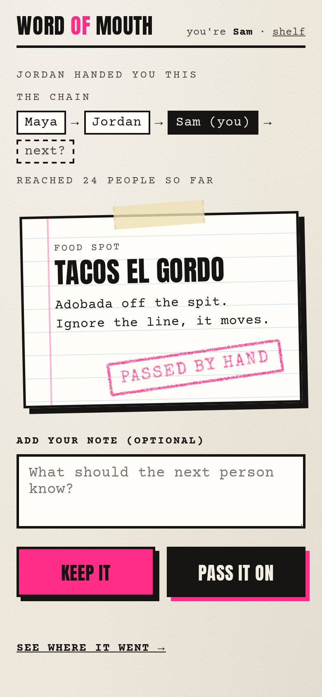

# Word of Mouth

**No algorithm. Just people.**

Word of Mouth is an anti-Yelp for friends. Recs (food spots, songs, books, anything) can only spread hand to hand, between people who actually trust each other. There's no public feed, no search, no likes and no ratings. You only see a rec when someone hands it to you, and every rec shows the chain it travelled: `Maya -> Jordan -> you`.


## How it works

1. **Start a rec.** Give it a title, a short note and an optional link.
2. **Pass it on.** Choose how to hand it over:
   - **One person:** type their name to get a link and QR code that works once. The first person to open it joins the chain after you.
   - **The whole room:** one link for everyone. Each person who opens it joins as a new branch under you.
   Text the link, or let them scan the QR code off your phone.
3. **Open a link someone sent you.** You see the rec, who handed it to you, the whole chain behind it and everyone's notes. Tap **Keep it** to save it, add your own note, and pass it on further.
4. **My shelf** lists the recs you got, the ones you passed on and the ones you started.
5. **See where it went** opens a live tree of everyone the rec reached. It refreshes every 2 seconds. New names draw in and flash pink so the room can spot themselves, and a giant QR code invites the next person in. On a phone the tree stacks and scrolls; on a projector it fits on one screen.

There are no accounts. The first time you open the app it asks what people call you, and it remembers that on your phone only.



## Run it

You need Python 3.11+ and [uv](https://docs.astral.sh/uv/).

```bash
uv run word-of-mouth
```

Then open http://127.0.0.1:8080. Data is kept in one SQLite file under `data/.apps/word-of-mouth/`. Set `WORD_OF_MOUTH_PORT` or `WORD_OF_MOUTH_DATA_DIR` to change the port or where data lives.

### Let phones in

Pass-along links have to open on anyone's phone. `run_public_address.sh` downloads [cloudflared](https://github.com/cloudflare/cloudflared) and opens a free Cloudflare quick tunnel to the app, with no account needed. It writes the public `https://….trycloudflare.com` address to `data/.apps/word-of-mouth/public_url.txt`, and the app uses that address for every link and QR code it makes.

```bash
./run_public_address.sh
```

The quick-tunnel address changes each time the script restarts, so start it once before you share any QR codes.

## Under the hood

- `src/word_of_mouth/store.py` holds the data model. Every person a rec reaches is a node in that rec's tree, and a node's parent is whoever handed it to them. Links are one-use (`one`) or open to all (`group`).
- `src/word_of_mouth/runner.py` serves the JSON API, the QR codes (SVG) and the page.
- `src/word_of_mouth/assets/app.html` is the whole front end in one file: a punk-zine look with newsprint, index cards, rubber stamps and a hand-drawn tree.

Built in one evening for a hackathon demo.
